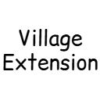

# Village Extension
  
  
村開発をするのに役立つさまざまなアイテムを含んでいます。  
This mod includes many items for developing village.

## Disclaimer
本Modは、既存のキャラクターに着想を得た非公式のファンメイド作品を含みます。  
関連するキャラクター・名称・商標の権利は、各権利者様に帰属します。  
本ModはMojang/Microsoftや各権利者様とは一切関係がなく、承認・提携も受けていません。  
本Modは非営利・無料で配布しています。  
権利者様からのご要望があった場合は、速やかに修正または配布停止の対応をいたします。  
連絡先: fuyossi[@]fuyossi[.]com  
※メールアドレスの括弧を削除してからメールをご送信ください。  

This mod contains unofficial fan-made contents. All rights to the original characters and names belong to each rights holders. This mod is not affiliated with, endorsed by, or sponsored by Mojang, Microsoft, or each rights holders. Distributed free of charge. Will be modified or removed upon request from the rights holder.  
contact: fuyossi[@]fuyossi[.]com  
*Please remove all brackets before sending an email.

## About Licensing
Copyright (c) 2026 fuyossi  
Released under the MIT license  
[https://opensource.org/licenses/mit-license.php](https://opensource.org/licenses/mit-license.php)
